 

 

### 👋 你好，我是壹樂

全栈工程师，坐标深圳。现在主攻一件事：**把 AI Agent 做进真实的业务系统** —— 能调工具，守得住权限，算得清成本。

- 🧭 **五年半**：前端起步 → 后端与架构 → AI 应用与 Agent，界面、服务、数据、模型一条链路都能扛
- 🏭 **现在**：在一家上市制造企业做集团级业务平台
- 🤖 **工作方式**：Claude Code / Codex 是日常搭档；项目约定和踩坑记录写进 CLAUDE.md、AGENTS.md 与 Agent Skills，让 Agent 按规矩干活
- 🎯 **擅长**：Agent 工程（工具调用 · MCP · 权限与审计）· RAG 检索 · 后端架构 · 全链路性能调优 · 大规模数据可视化
- 💌 **联系**：[ita201125@gmail.com](mailto:ita201125@gmail.com)

<table>
  <tr>
    <td width="33%" valign="top">
      <b>🤖 Agent 先管住权限</b> 
      它能做的事 = 当前用户能做的事；写操作先预演、本人确认才执行，全程留审计。
    </td>
    <td width="33%" valign="top">
      <b>🧠 AI 不止做 demo</b> 
      RAG、MCP、记忆压缩都要上线扛事：检索准不准、Token 花多少，都得管住。
    </td>
    <td width="33%" valign="top">
      <b>🏗️ 后端是底气</b> 
      审批流、跨系统分发、身份认证先划清边界；性能用数字说话，600 节点拓扑提速 70%。
    </td>
  </tr>
</table>

 

## 🛠️ 技术栈

  

 

 

| | |
| :-- | :-- |
| **AI · Agent** | `Tool Calling` `MCP（接工具 + 对外网关）` `Agent 意图路由` `pydantic-ai` `权限约束的工具调用` `写操作预演 + 人工确认` `调用审计` `会话记忆压缩` `Prompt 工程` |
| **AI · RAG** | `RAG 全链路` `基于文档结构的分块` `Embedding` `向量数据库` `稠密 + 稀疏多路检索` |
| **AI 协作开发** | `Claude Code` `Codex` `Agent Skills` `CLAUDE.md / AGENTS.md 分层上下文` |
| **后端 · Python** | `FastAPI` `Pydantic 2` `SQLAlchemy 2（async）` `Alembic` `Celery` `Django / DRF` |
| **后端 · Java** | `Java 17` `Spring Boot 3` `Spring Security` `MyBatis-Plus` `Sa-Token` `OAuth2 / OIDC` |
| **前端** | `React 19` `Vue 2/3` `TypeScript` `TanStack Router / Query / Table` `Tailwind CSS` `shadcn/ui` `zustand` `Pinia` `i18next` |
| **可视化** | `ECharts / ECharts-gl` `GoJS` `AG-Grid Enterprise` |
| **多端** | `Electron` `Expo / React Native` `小程序` `H5` |
| **数据与存储** | `PostgreSQL / KingbaseES` `MySQL` `SQL Server` `MongoDB` `Redis` `S3 对象存储` |
| **架构** | `微前端 qiankun` `Monorepo（pnpm + turbo）` `事务性 Outbox` `审批流引擎` `RBAC + 行级数据权限` `Socket.IO 实时推送` |
| **工程化** | `Vite` `Docker` `GitLab CI` `GitHub Actions` `阿里云云效` `uv / ruff` `VitePress` |
| **测试** | `pytest` `Playwright 端到端` |

 

## ⚙️ 做过的事

- 🤖 AI 助手与登录人权限对齐：工具调用受功能权限和数据范围约束，写操作先预演、确认后才执行，全程审计
- 🔌 MCP 网关把同一套受约束的能力开放给外部 Agent；工具动态调用 + 长程会话记忆压缩，控 Token 成本
- 🧠 RAG 全链路自建：分块 → 向量化 → 入库 → 稠密 + 稀疏多路检索
- 🎨 大模型辅助图形空间布局，替代失真的传统图论算法
- 🛠️ 日常开发与 Claude Code / Codex 结对，把提交规范、项目约定沉淀成 Agent Skills
- ⚙️ 审批流引擎分层设计，运行时对外只暴露业务门面与 SPI
- 📤 待办跨系统分发走事务性 Outbox + 租约式 relay，替掉事务内远程调用
- 🔐 实现 OAuth2 / OIDC 身份提供方，含令牌自省、吊销与登出
- 🚀 百万级数据查询优化，Redis 多级缓存 + 执行计划调优 + 中间表预计算
- 🕸️ 600 节点行业拓扑图渲染提速 **70%**，稳定 60fps

<b>展开更多技术实践</b>

 

**AI 工程**

- 跑通「采集 → 清洗 → 分块 → 向量化 → 入库 → 检索」全链路
- 稠密 + 稀疏多路检索，基于文档结构的分块策略
- 会话记忆压缩：保留近 N 轮并自动摘要，控 Token 成本同时保上下文连续
- Agent 写操作走「预演 → 确认 → 执行 → 审计」，外部系统经 MCP 网关调用同一套受权限约束的能力

**AI 协作开发**

- 根目录 CLAUDE.md 只放跨模块的硬纪律，模块级踩坑拆进各目录的 AGENTS.md，Agent 改到哪就带上哪份上下文
- 自写 Agent Skills：按暂存改动生成规范的中文提交信息，把项目与知识笔记分流进知识库

**后端**

- `CompletableFuture` 并行取多源数据；万人级统计报表解决深度分页与大表关联瓶颈
- 微信支付 V3 接入，配套带补偿机制的异步流程保证最终一致
- Django + DRF 对接计算引擎，负责多维结果的清洗、重采样与序列化，配合 RBAC 交付 API

**前端与可视化**

- GoJS 增量更新 + 视口裁剪 + 定制连线算法
- AG-Grid Enterprise 多实例缓存，GridApi 状态托管解决多表切换内存激增
- 微前端 + Monorepo 共享组件库建设，unplugin 按需引入削减包体积
- 拆解耦合严重的上帝组件，用 Composition API 与 JSX 抽离通用逻辑
- 小程序与 H5 跨端通信（`web-view` + `postMessage`）、分包、虚拟列表
- ECharts-gl 三维可视化大屏，含多分辨率适配

**异构与工程化**

- Meteor 框架从零预研，构建链路与部署全生命周期打通；二次开发多租户隔离与 SSO 免登
- Electron 桌面端交付、Web 端条码打印机集成
- 电视端遥控器焦点导航与 IE6+ 适配（epg-focus、Polyfill、极小内存 DOM 精简）
- 主导 ESLint / Commitlint / GitHooks 规范落地与文档体系建设

 

